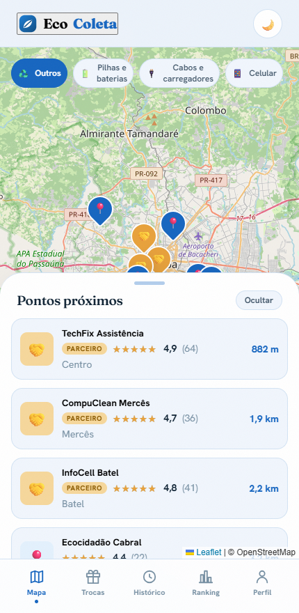

# EcoColeta

Aplicação web que ajuda o morador de Curitiba a encontrar pontos de descarte de lixo eletrônico, registrar o descarte com QR Code e ganhar pontos trocáveis por recompensas.

> **Projeto acadêmico desenvolvido em grupo** na faculdade. Este repositório reúne o front-end (SPA) do projeto, rodando sobre dados simulados (mock); não há backend em produção.

<p align="center"></p>

## Stack

- React 19 + TypeScript + Vite 7
- React Router 7 (hash router), TanStack Query 5
- Leaflet + React Leaflet com tiles do OpenStreetMap
- `qrcode.react` para geração de QR Code
- CSS próprio com design tokens (tema claro e escuro)

## Destaques técnicos

- **Mapa com busca por proximidade**: pontos ordenados por distância calculada com a fórmula de haversine, filtro por categoria de material e lista recolhível; no desktop o mapa ocupa a tela e a lista vira painel lateral.
- **Gamificação**: pontos por unidade descartada conforme a categoria (pilha, cabo, celular, notebook, eletrodoméstico...), 5 níveis de progressão, ranking e catálogo de recompensas.
- **Três áreas no mesmo app**: cidadão (`/app`: mapa, descarte, QR, trocas, histórico, ranking, conteúdo educativo, perfil), parceiro (`/partner`: validação do QR e dados do ponto) e administração (`/admin`: catálogo, parceiros, resgates e indicadores), cada uma com guarda de rota.
- **Camada de dados pronta para backend**: endpoints tipados atrás de uma flag (`VITE_API_MODE`); hoje servem fixtures com latência simulada, consumidas via TanStack Query com invalidação após mutações.
- **Build que abre direto do disco**: `vite-plugin-singlefile` + `base: './'` + hash router geram um único `index.html` que funciona via `file://`, útil para entrega acadêmica sem servidor.
- **UX**: skeletons nas listagens, toasts, empty states e layout responsivo (bottom nav no mobile, abas no topo no desktop).

## Como rodar

```bash
npm install
npm run dev       # http://localhost:5173
npm run build     # gera dist/index.html autocontido
npm run preview
```

As áreas de parceiro e admin usam um login de demonstração validado só no navegador (protótipo, sem segurança real).

## Estrutura

```
src/
  screens/      telas do cidadão (mapa, descarte, QR, trocas, ranking...)
  partner/      área do parceiro
  admin/        painel administrativo
  api/          endpoints, fixtures e flag mock/live
  lib/          queries (TanStack Query), tema, toasts
  components/   shell e componentes de UI
  catalog.ts    categorias, pontuação, níveis e haversine
  styles/       tokens e estilos globais
```

## English

EcoColeta is a group university project: a React 19 + Vite SPA that maps e-waste drop-off points in Curitiba, Brazil.
Users find nearby points on a Leaflet map, register disposals with a QR code and earn points, levels and rewards.
Runs on mock data, with citizen, partner and admin areas and a single-file build that opens straight from disk.
